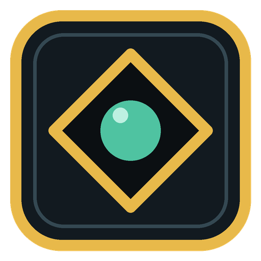
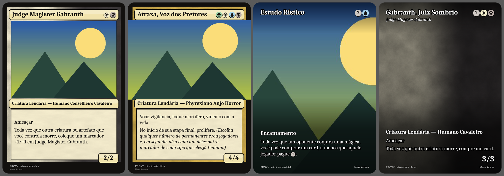
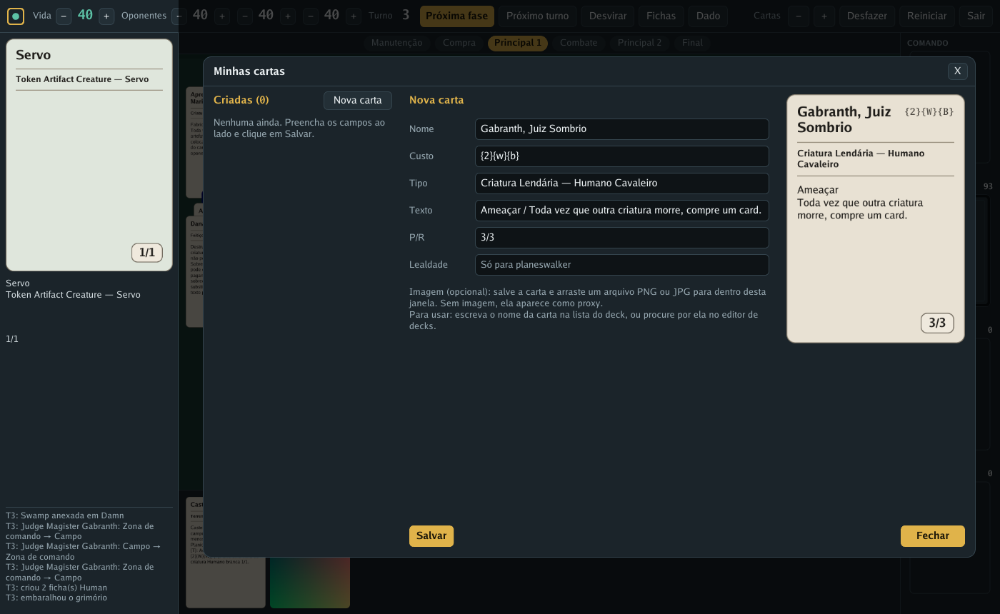
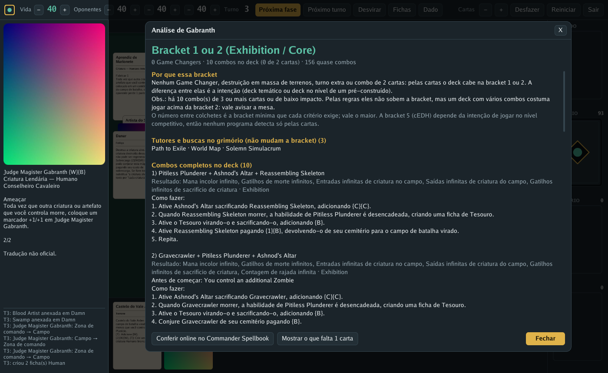
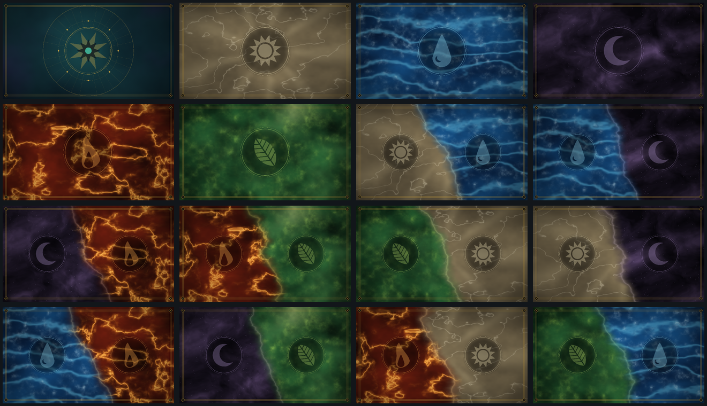
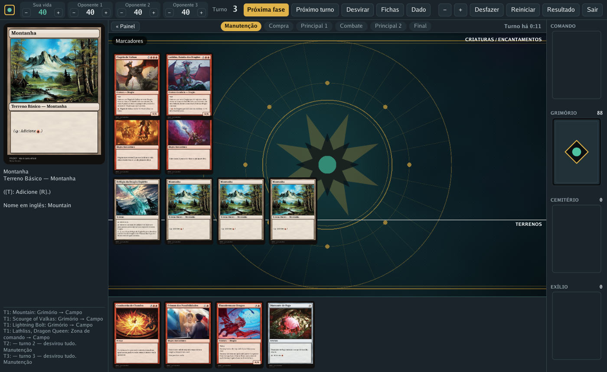
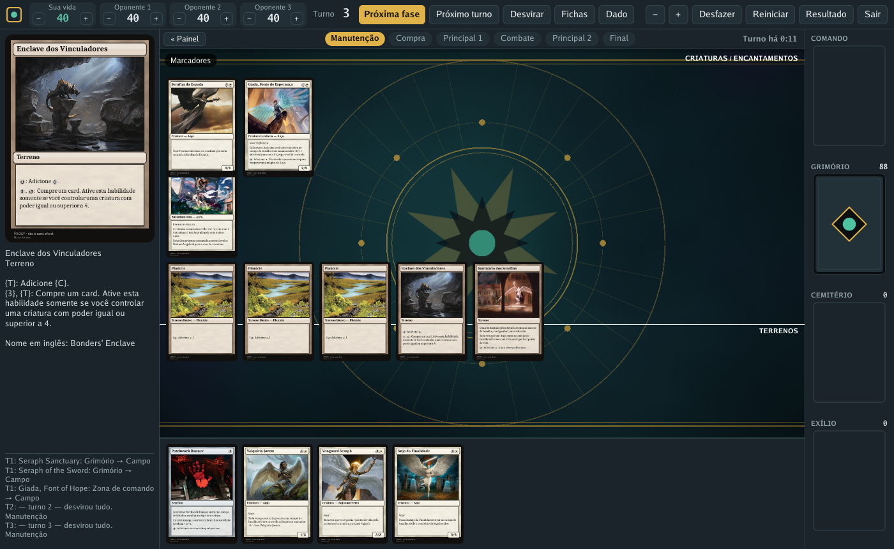

<p align="center"></p>

# Mesa Arcana 2.0


Simulador offline manual de Commander (Magic: The Gathering) para testar decks sozinho ou em rede local. Roda de um pendrive, sem instalar nada e sem internet: o texto de todas as cartas já vem dentro do programa.


## O que tem

- **Funciona sem internet.** Sem a imagem da carta, ela aparece como um proxy de playtest (nome, custo, tipo, texto e P/R). Com internet, dá para baixar as imagens do Scryfall por deck e escolher a arte de cada carta e ficha.
- **Importa qualquer lista**: Moxfield, Archidekt, Arena, MTGO, EDHREC ou texto puro, com nomes em inglês ou português. Nomes errados ganham sugestão.
- **Cartas em português**: texto oficial quando existe, tradução não oficial (marcada) para parte das outras, e botão para voltar ao inglês.
- **Bracket e combos**: estima a bracket do deck pelos critérios oficiais e lista os combos, com o passo a passo de cada um.
- **Mesa de jogo**: mulligan, fases anunciadas, fichas, contadores, equipar/anexar, imposto de comandante manual, vidência, desfazer.
- **Multijogador em rede local**: um cria a mesa, os outros entram pelo endereço. Tem chat, mão revelada, ordem dos turnos no d20, vida de cada oponente em tempo real, zoom e cemitério/exílio das cartas dos outros, e cada um vê o playmat e a sleeve que os outros escolheram.
- **Aparência**: playmat padrão, 5 playmats de cor e 10 de duas cores desenhados pelo programa, sleeves prontas e as suas próprias (pastas `playmats` e `sleeves`). As cartas na mesa podem aparecer como imagem oficial, moldura + ilustração, arte estendida, arte inteira ou proxy simples (tecla E).
- **Busca no grimório** com filtros de tipo, custo de mana e cor.
- **Atalhos trocáveis** (F1), mover a carta com o mouse em cima (G, X, H, B), menu da pilha inteira no cemitério e no exílio, e **histórico de partidas** com taxa de vitória por deck (botão "Resultado").
- **Partida contra a IA** (Windows, celular e PSP): escolha o deck da IA e treine o seu. A IA joga terrenos, conjura o que puder pagar, ataca e bloqueia; o dano do combate é aplicado sozinho. Ela é simples e lê só alguns efeitos (remoções e compra).
- **Versão para PSP** (veja abaixo).
- **Criador de cartas** próprias, que entram nos decks pelo nome.
- **Fazedor de proxies**: qualquer carta (ou as suas) no formato de carta de Magic, em três estilos (moldura, arte estendida e arte inteira), baixando só a ilustração. Grava PNG no tamanho de impressão ou folhas A4 com 9 cartas. Moldura e símbolos são desenhados pelo programa e toda carta sai marcada como proxy.



| Aparência | Criar carta | Bracket e combos |
|---|---|---|
|  |  |  |



## Como usar

O jeito de jogar e os atalhos estão no [LEIA-ME.txt](LEIA-ME.txt).

### Baixar pronto (Windows)

**[Baixar o MesaArcana-Windows.zip](https://github.com/kykybalao/mesa-arcana/raw/main/download/MesaArcana-Windows.zip)** (42 MB). Extraia a pasta onde quiser (pode ser no pendrive) e abra o `MesaArcana.exe`. Não precisa instalar nada. Já vem com decks prontos para jogar: o Gabranth e os 5 decks de Commander de Foundations (Calling All Angels (Giada, branco), Keen Engineering (Sai, azul), Wretched Ranks (Ghoulcaller Gisa, preto), Reign of Dragons (Lathliss, vermelho) e Tramplesaurus Rex (Ghalta, verde)).

Na primeira vez o Windows pode mostrar o aviso "O Windows protegeu o computador", porque o programa não é assinado. Clique em "Mais informações" e depois em "Executar assim mesmo".

As cartas dos decks de Foundations já vêm com as ilustrações baixadas (`dados/artes`), desenhadas na moldura do Mesa Arcana, então funcionam sem internet.

|  |  |
|---|---|

### Compilar o programa (Windows)

Precisa do [Go](https://go.dev/dl/) 1.26 ou mais novo. Na pasta do projeto:

```
go build -trimpath -ldflags "-s -w -H=windowsgui" -o MesaArcana.exe .
```

Copie o `MesaArcana.exe` para onde quiser. Ele cria ao lado as pastas `decks`, `dados`, `playmats` e `sleeves`.

Para compilar no Linux para Windows: `GOOS=windows GOARCH=amd64 CGO_ENABLED=0 go build -trimpath -ldflags "-s -w -H=windowsgui" -o MesaArcana.exe .`

### Celular (Android)

**[Baixar o MesaArcana-Android.apk](https://github.com/kykybalao/mesa-arcana/raw/main/download/MesaArcana-Android.apk)** (13 MB). Abra o arquivo no celular e permita "instalar apps desconhecidos" quando o Android pedir.

Já vem com os 5 decks de Commander de Foundations. Feito para toque: toque vira/desvira, toque duplo na mão joga a carta, arrastar move, **segurar** a carta abre o menu (com "Ampliar carta"). O botão **Contra a IA** em cada deck começa uma partida contra a IA. O texto das cartas funciona sem internet; as imagens vêm do Scryfall quando há conexão.


O código fica em `mobile/` (a página) e `android/` (o app; `android/build.sh` gera o APK com o Android SDK).

### PSP

**[Baixar o MesaArcana-PSP.zip](https://github.com/kykybalao/mesa-arcana/raw/main/download/MesaArcana-PSP.zip)** (10 MB). Precisa de um PSP com firmware customizado.

1. Copie a pasta `PSP` do zip para a raiz do Memory Stick. Já dá para jogar: vem com os 5 decks de Commander de Foundations, já com as cartas ilustradas.
2. Para jogar com outros decks, no programa do PC escolha o deck e clique em **PSP**. Ele grava `PSP/GAME/MesaArcana/decks/<deck>` ao lado do programa; copie essa pasta para o Memory Stick também.
3. No PSP, R + SELECT mostra todos os atalhos.

Joga sozinho ou em rede entre até 4 PSPs (Wi-Fi ad hoc). Tem painel da carta com texto grande, nome e custo nas cartas, equipar/prender, mulligan, fichas, marcadores, busca no grimório e histórico de partidas. Mais detalhes no [LEIA-ME do PSP](psp/LEIA-ME.txt).

| Mesa | Atalhos |
|---|---|
|  |  |  |

Para compilar: instale o [pspdev](https://github.com/pspdev/pspdev) (traz SDL2, SDL2_ttf e SDL2_image) e, na pasta `psp`:

```
mkdir build && cd build && psp-cmake .. && make
```

Junte o `EBOOT.PBP` com as fontes `ui.ttf` e `uib.ttf` (Go Regular e Go Bold) na pasta `PSP/GAME/MesaArcana`.

### Versão HTML

A pasta [`html`](html) tem uma versão que abre no navegador (`MesaArcana.html`), sem multijogador, sem o criador de cartas e sem o fazedor de proxies. Baixe a pasta inteira, porque ela precisa dos arquivos de `html/dados`.

## Organização

| Pasta ou arquivo | O que é |
|---|---|
| `*.go` | Código do programa (Go + [Ebitengine](https://ebitengine.org/)) |
| `dados/` | Bancos embutidos: cartas, combos e textos em português |
| `build/` | Scripts que montam esses bancos e os roteiros de teste |
| `html/` | Versão para navegador |
| `psp/` | Versão para PSP (C + SDL2) |
| `download/` | Programas prontos (Windows e PSP) |
| `decks/` | Decks de exemplo: Gabranth e os 5 decks de Commander de Foundations |

Os scripts de `build/` foram escritos para a máquina onde o projeto nasceu e têm caminhos fixos (`/home/user/mesa`); ajuste antes de rodar.

## Créditos

- Dados e imagens das cartas: [Scryfall](https://scryfall.com/). O programa não acompanha nenhuma imagem; elas são baixadas do Scryfall pelo próprio usuário.
- Combos, passo a passo e classificação de bracket: [Commander Spellbook](https://commanderspellbook.com/). A popularidade usada para ordenar vem do [EDHREC](https://edhrec.com/).
- Fonte das cartas: [Caladea](https://github.com/huertatipografica/Caladea), de Carolina Giovagnoli e Andrés Torresi (SIL Open Font License 1.1).
- Motor gráfico: [Ebitengine](https://ebitengine.org/), de Hajime Hoshi.
- Versão PSP: [pspdev](https://github.com/pspdev/pspdev) e [SDL2](https://www.libsdl.org/). Fontes da versão PSP: [Go fonts](https://go.dev/blog/go-fonts), da Bigelow & Holmes (licença BSD).
- Código escrito com o [Claude](https://claude.ai/), da Anthropic, a partir das ideias e dos testes do Kyky.

Projeto de fã, não oficial, sem fins lucrativos. Magic: The Gathering, os nomes e os textos das cartas são propriedade da Wizards of the Coast. Este projeto não é afiliado, endossado nem patrocinado pela Wizards of the Coast, pelo Scryfall, pelo Commander Spellbook ou pelo EDHREC.
