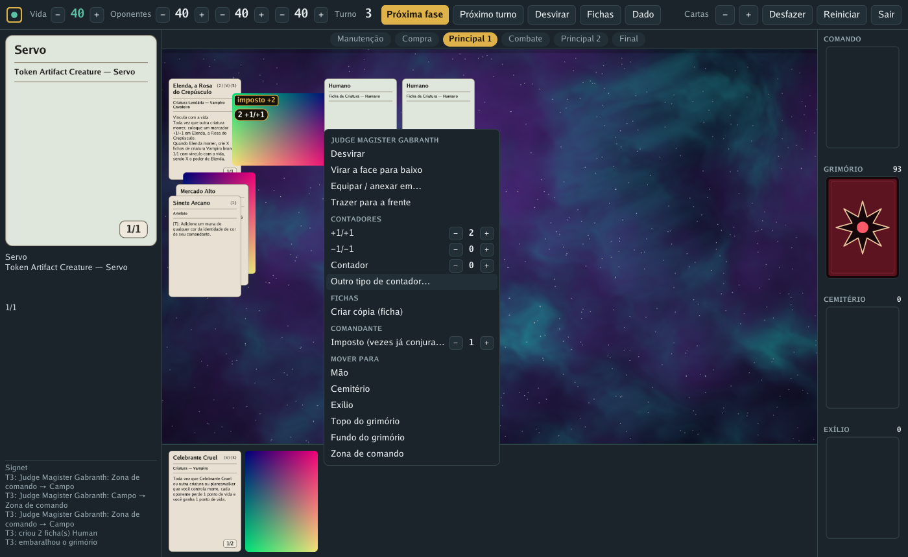
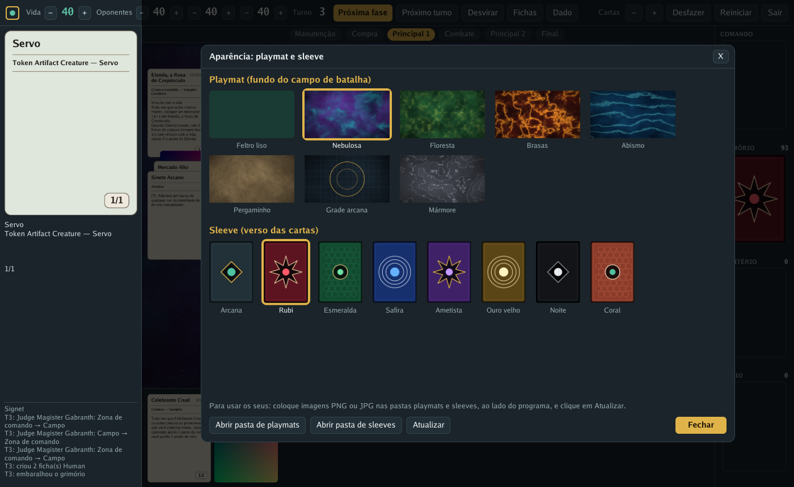

<p align="center"></p>

# Mesa Arcana

Projetinho vibecoded, eu não sei programar, ficou meio merda, pedi pra IA deixar bonito pelo menos.

Simulador offline de Commander (Magic: The Gathering) para testar decks sozinho ou em rede local. Roda de um pendrive, sem instalar nada e sem internet: o texto de todas as cartas já vem dentro do programa.



## O que tem

- **Funciona sem internet.** Sem a imagem da carta, ela aparece como um proxy de playtest (nome, custo, tipo, texto e P/R). Com internet, dá para baixar as imagens do Scryfall por deck e escolher a arte de cada carta e ficha.
- **Importa qualquer lista**: Moxfield, Archidekt, Arena, MTGO, EDHREC ou texto puro, com nomes em inglês ou português. Nomes errados ganham sugestão.
- **Cartas em português**: texto oficial quando existe, tradução não oficial (marcada) para parte das outras, e botão para voltar ao inglês.
- **Bracket e combos**: estima a bracket do deck pelos critérios oficiais e lista os combos, com o passo a passo de cada um.
- **Mesa de jogo**: mulligan, fases anunciadas, fichas, contadores, equipar/anexar, imposto de comandante manual, vidência, desfazer.
- **Multijogador em rede local**: um cria a mesa, os outros entram pelo endereço. Tem chat e dá para revelar a mão.
- **Aparência**: playmats e sleeves prontos, e os seus próprios (pastas `playmats` e `sleeves`).
- **Criador de cartas** próprias, que entram nos decks pelo nome.

| Aparência | Criar carta | Bracket e combos |
|---|---|---|
|  |  |  |

## Como usar

O jeito de jogar e os atalhos estão no [LEIA-ME.txt](LEIA-ME.txt).

### Baixar pronto (Windows)

**[Baixar o MesaArcana-Windows.zip](https://github.com/kykybalao/mesa-arcana/raw/main/download/MesaArcana-Windows.zip)** (19 MB). Extraia a pasta onde quiser (pode ser no pendrive) e abra o `MesaArcana.exe`. Não precisa instalar nada.

Na primeira vez o Windows pode mostrar o aviso "O Windows protegeu o computador", porque o programa não é assinado. Clique em "Mais informações" e depois em "Executar assim mesmo".

### Compilar o programa (Windows)

Precisa do [Go](https://go.dev/dl/) 1.26 ou mais novo. Na pasta do projeto:

```
go build -trimpath -ldflags "-s -w -H=windowsgui" -o MesaArcana.exe .
```

Copie o `MesaArcana.exe` para onde quiser. Ele cria ao lado as pastas `decks`, `dados`, `playmats` e `sleeves`.

Para compilar no Linux para Windows: `GOOS=windows GOARCH=amd64 CGO_ENABLED=0 go build -trimpath -ldflags "-s -w -H=windowsgui" -o MesaArcana.exe .`

### Versão HTML

A pasta [`html`](html) tem uma versão que abre no navegador (`MesaArcana.html`), sem multijogador e sem o criador de cartas. Baixe a pasta inteira, porque ela precisa dos arquivos de `html/dados`.

## Organização

| Pasta ou arquivo | O que é |
|---|---|
| `*.go` | Código do programa (Go + [Ebitengine](https://ebitengine.org/)) |
| `dados/` | Bancos embutidos: cartas, combos e textos em português |
| `build/` | Scripts que montam esses bancos e os roteiros de teste |
| `html/` | Versão para navegador |
| `decks/` | Deck de exemplo |

Os scripts de `build/` foram escritos para a máquina onde o projeto nasceu e têm caminhos fixos (`/home/user/mesa`); ajuste antes de rodar.

## Créditos

- Dados e imagens das cartas: [Scryfall](https://scryfall.com/). O programa não acompanha nenhuma imagem; elas são baixadas do Scryfall pelo próprio usuário.
- Combos, passo a passo e classificação de bracket: [Commander Spellbook](https://commanderspellbook.com/). A popularidade usada para ordenar vem do [EDHREC](https://edhrec.com/).
- Motor gráfico: [Ebitengine](https://ebitengine.org/), de Hajime Hoshi.
- Código escrito com o [Claude](https://claude.ai/), da Anthropic, a partir das ideias e dos testes do Kyky.

Projeto de fã, não oficial, sem fins lucrativos. Magic: The Gathering, os nomes e os textos das cartas são propriedade da Wizards of the Coast. Este projeto não é afiliado, endossado nem patrocinado pela Wizards of the Coast, pelo Scryfall, pelo Commander Spellbook ou pelo EDHREC.
