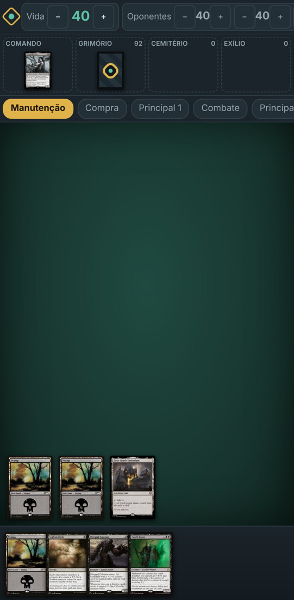

# Mesa Arcana 2.0 para celular (Android)

A mesa de teste de Commander no celular, feita para toque.

[Baixar o MesaArcana-Android.apk](https://github.com/kykybalao/mesa-arcana/raw/main/download/MesaArcana-Android.apk) · [O que mudou](../CHANGELOG.md)

## Instalar

1. Baixe o `MesaArcana-Android.apk` no celular e abra o arquivo.
2. Quando o Android pedir, permita **instalar apps desconhecidos** para o navegador ou para o gerenciador de arquivos.
3. Toque em **Instalar**.

Se você já tinha a versão anterior, a 2.0 instala por cima. Os seus decks continuam lá.

Na primeira vez, o app já traz os 5 decks de Commander de Foundations.

## Controles

| Gesto | O que faz |
|---|---|
| Tocar numa carta do campo | Vira ou desvira |
| Toque duplo numa carta da mão | Joga a carta |
| Arrastar | Move entre mão, campo, cemitério, exílio, grimório e comando |
| Segurar a carta | Abre o menu (ampliar, contadores, equipar, transformar, fichas) |
| Tocar no grimório | Compra uma carta |
| Segurar o grimório | Busca, vidência, moer, embaralhar |

Os botões de baixo fazem o resto: **Próxima fase**, **Próximo turno**, **Desvirar**, **Fichas**, **Dado** e **Desfazer**.

## Jogar contra a IA

1. Na lista de decks, toque em **Contra a IA** no seu deck.
2. Escolha o deck da IA. A mesa dela aparece numa faixa em cima.
3. Durante a partida:
   - **Próximo turno** faz a IA jogar o turno dela;
   - **Atacar a IA** abre a lista para escolher os atacantes;
   - quando ela ataca, você escolhe os bloqueadores.

O que acontece sozinho:
- o dano de combate entre você e a IA muda a vida dos dois;
- as criaturas que morrem vão para o cemitério.

A IA lê só remoção e compra; os outros efeitos das cartas dela são ignorados.

## Seus decks

Use **Importar deck** e cole a lista (Moxfield, Archidekt, Arena, MTGO ou texto puro). Também dá para abrir um `.txt` ou um pacote offline (`.json`) gerado pelo Mesa Arcana.

## Internet

O texto das cartas funciona sem internet. As imagens vêm do Scryfall quando há conexão.

## Requisitos

Android 7 ou mais novo. Ainda não foi testado em muitos aparelhos. Se algo não funcionar, conte qual é o celular.
