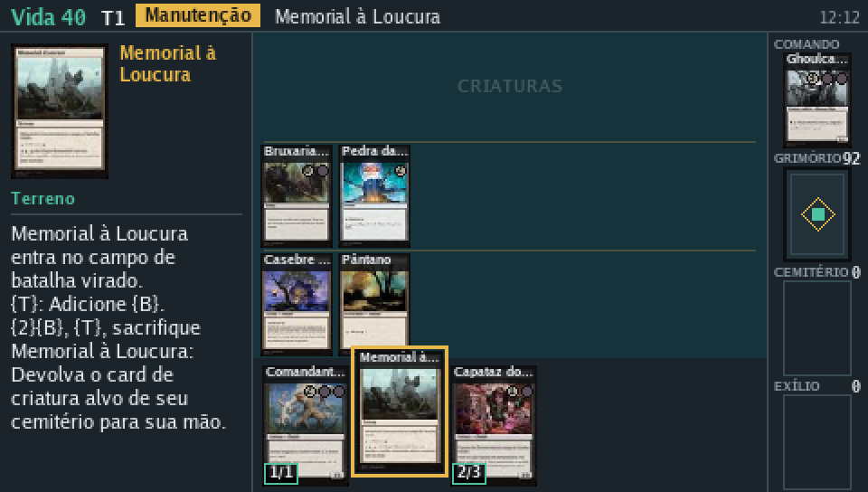
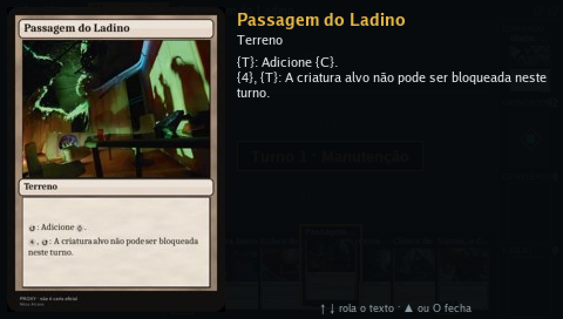
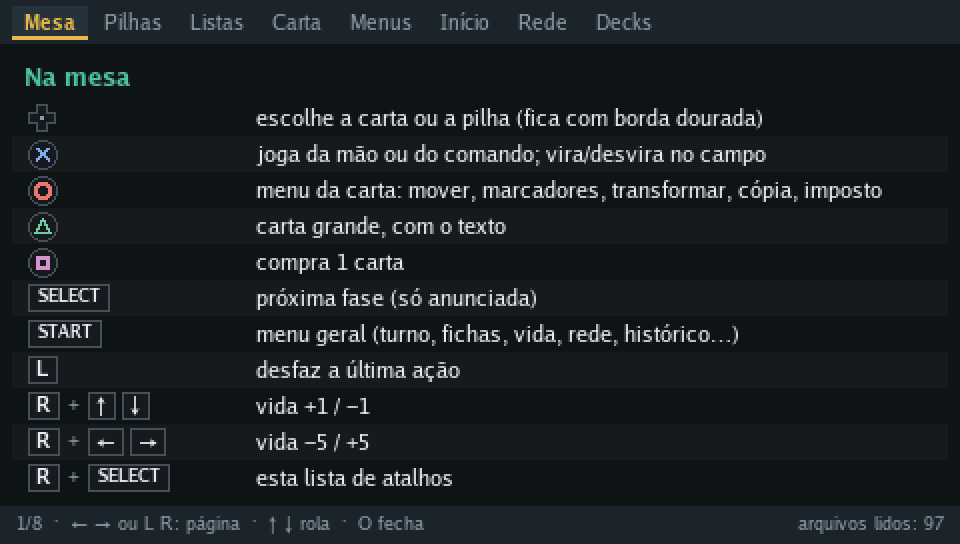

# Mesa Arcana 2.0 para PSP

A mesa de teste de Commander no PSP. Joga sozinho, contra a IA ou em rede entre até 4 PSPs.

[Baixar o MesaArcana-PSP.zip](https://github.com/kykybalao/mesa-arcana/raw/main/download/MesaArcana-PSP.zip) · [O que mudou](../CHANGELOG.md) · [LEIA-ME completo](../psp/LEIA-ME.txt)

| Mesa | Zoom | Atalhos |
|---|---|---|
|  |  |  |

## Instalar

Precisa de um PSP com firmware customizado (CFW), por exemplo PRO ou ARK.

1. Copie a pasta `PSP` do zip para a raiz do Memory Stick. Fica `PSP/GAME/MesaArcana/EBOOT.PBP`.
2. Abra pelo menu Jogo do PSP.

Já vem com os 5 decks de Commander de Foundations, com as cartas ilustradas.

## Usar os seus decks

1. No programa do Windows, escolha o deck e clique em **PSP**.
2. Copie a pasta `decks` que ele criou para `PSP/GAME/MesaArcana/` no Memory Stick.

## Controles principais

| Botão | O que faz |
|---|---|
| X | Ação principal: jogar carta, virar ou desvirar, comprar |
| O | Menu da carta ou do monte |
| △ | Ampliar a carta |
| □ | Comprar uma carta (na lista de decks, marca o deck da IA) |
| SELECT | Próxima fase |
| START | Menu geral |
| L | Desfazer |
| R + direcionais | Vida +1/−1 (cima/baixo) e +5/−5 (lados) |
| R + L | Alterna entre a sua mesa e a dos outros |
| R + □ | Esconde ou mostra o painel da carta |
| R + SELECT | Lista de todos os atalhos |

## Jogar contra a IA

1. Na lista de decks, aperte □ no deck que a IA vai usar. Ele ganha a etiqueta vermelha "deck da IA".
2. Escolha o seu deck com X.
3. No menu START:
   - **Passar a vez** faz a IA jogar o turno dela;
   - **Atacar a IA** abre a lista de atacantes.
4. Quando ela ataca, esquerda/direita troca o bloqueador de cada atacante, e **Confirmar bloqueios** resolve.
5. R + L mostra a mesa da IA.

O que acontece sozinho:
- o dano de combate entre você e a IA muda a vida dos dois;
- as criaturas que morrem vão para o cemitério.

## Rede entre PSPs

1. Ligue a chave do Wi-Fi.
2. No menu START, entre em **Jogar em rede**.
3. Todos escolhem a mesma sala (1 a 4). Não precisa de roteador.

Enquanto está na rede, a sua vida, a fase e o campo são enviados sozinhos para a sala. Use **Sair da rede** para parar.

## Dicas para o PSP

- Fica mais rápido em Memory Stick ou adaptador de cartão SD bom.
- O processador vai a 333 MHz só ao abrir o deck. Isso muda em START > Processador.
- START > Resultado e histórico guarda as suas partidas.
