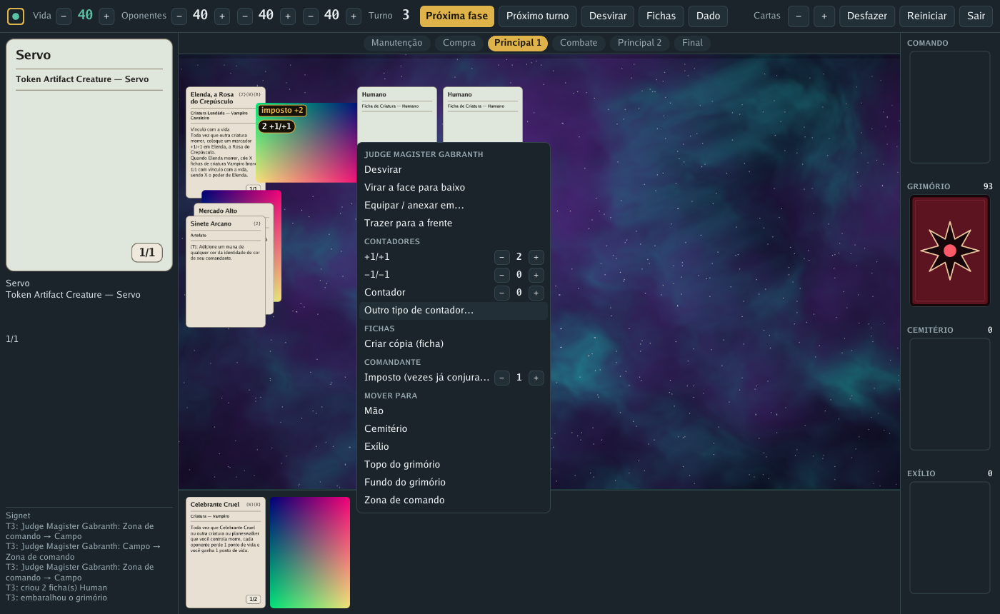

# Mesa Arcana 2.0 para Windows

Simulador offline de Commander. Roda de um pendrive, sem instalar nada e sem internet.

[Baixar o MesaArcana-Windows.zip](https://github.com/kykybalao/mesa-arcana/raw/main/download/MesaArcana-Windows.zip) · [O que mudou](../CHANGELOG.md) · [Todos os atalhos (LEIA-ME.txt)](../LEIA-ME.txt)

## Instalar

1. Extraia o zip onde quiser (pode ser no pendrive).
2. Abra o `MesaArcana.exe`.
3. Se aparecer "O Windows protegeu o computador", clique em "Mais informações" e depois em "Executar assim mesmo". O aviso aparece porque o programa não é assinado.

Já vem com o deck do Gabranth e os 5 decks de Commander de Foundations, com as ilustrações baixadas.

## Jogar sozinho

1. Na tela inicial, escolha o deck e clique em **Jogar**.
2. Faça o mulligan.
3. Jogue a partida:
   - **arraste** as cartas entre mão, campo, cemitério, exílio, grimório e comando;
   - **clique** numa carta do campo para virar ou desvirar;
   - **clique duplo** na mão joga a carta;
   - **botão direito** abre o menu completo (contadores, fichas, transformar, equipar, vidência).
4. Use **Próximo turno** para passar o turno. Ele só desvira tudo: a compra é manual (clique no grimório ou tecla D).

O F1 mostra todos os atalhos, e dá para trocar cada um.

## Jogar contra a IA

1. Escolha o seu deck e clique em **Contra a IA**.
2. Escolha o deck da IA. A mesa dela aparece em cima do campo.
3. Durante a partida:
   - **Próximo turno** faz a IA jogar o turno dela inteiro;
   - **Atacar a IA** abre a lista para marcar os atacantes;
   - quando ela ataca, abre a janela para escolher os bloqueadores.

O que acontece sozinho:
- o dano de combate entre você e a IA muda a vida dos dois;
- as criaturas que morrem vão para o cemitério.

A IA é simples. Dos efeitos das cartas, lê só remoção e compra.

## Jogar em rede local

1. Um jogador clica em **Multijogador (rede local)** e depois em **Criar mesa**.
2. Os outros digitam o endereço que aparece (ex.: 192.168.0.12) e clicam em **Entrar**. Cabem até 6 jogadores, todos no mesmo Wi-Fi.
3. Na primeira vez, o Windows pergunta sobre o firewall. Clique em **Permitir**.

## Outras ferramentas

- **Novo deck / importar lista:** cola listas do Moxfield, Archidekt, Arena, MTGO ou do bloco de notas.
- **Bracket e combos:** estima a bracket e mostra os combos, com o passo a passo.
- **Imagens:**
  - **Baixar imagens deste deck** (precisa de internet);
  - **Baixar só as ilustrações** para a moldura do Mesa Arcana;
  - a tecla **E** troca o estilo das cartas na mesa.
- **PSP:** grava o deck pronto para o PSP.
- **Resultado:** registra a partida e mostra a taxa de vitória por deck.
- **Criar carta** e **Proxies:** cartas próprias e proxies para imprimir.

## Requisitos

Windows 10 ou 11, 64 bits. Internet só para baixar imagens.
